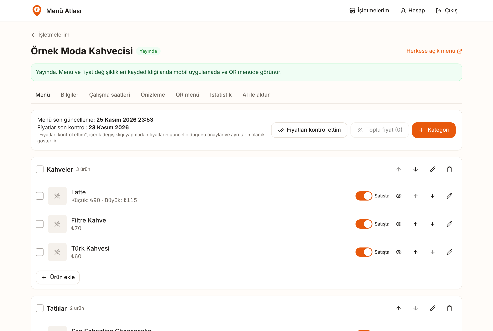
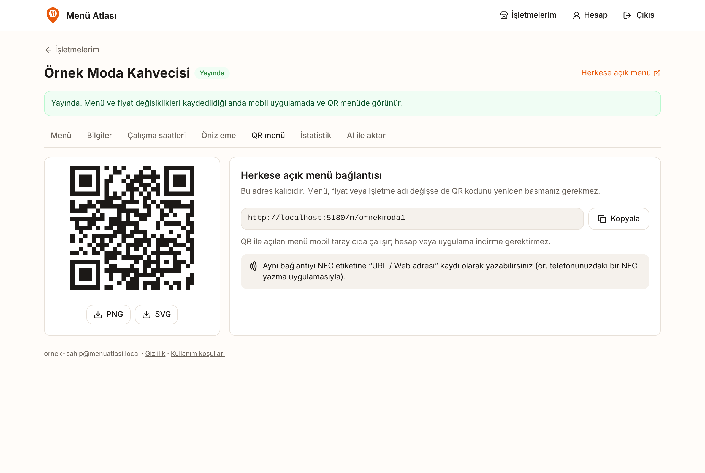
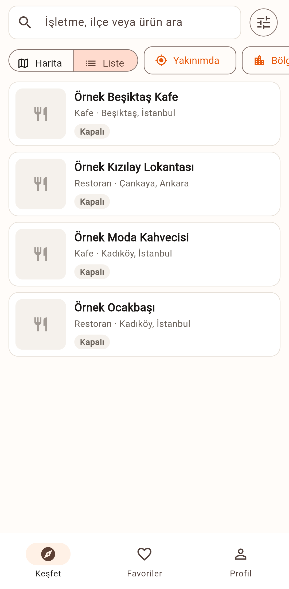
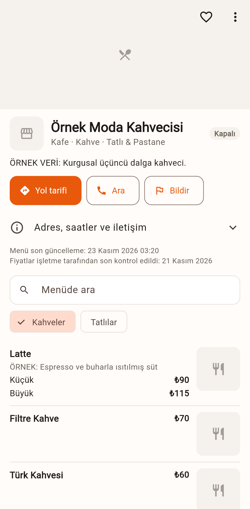
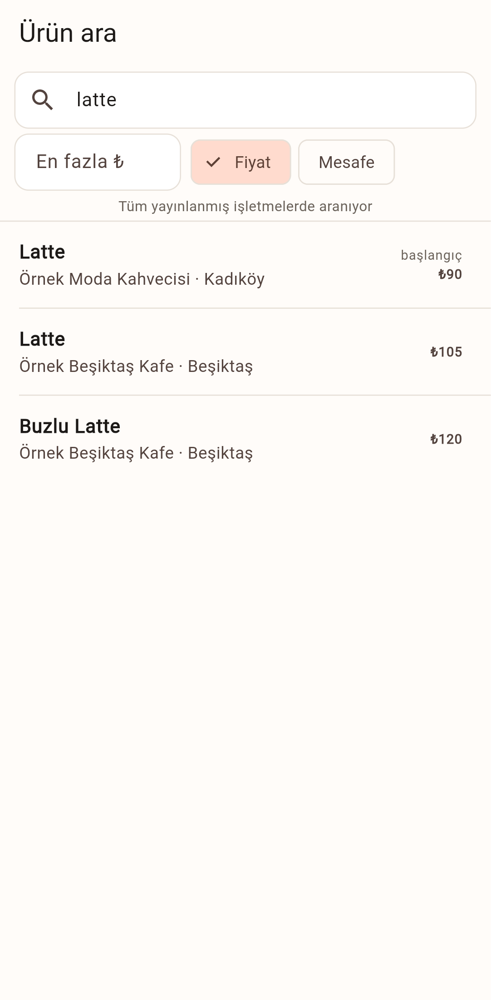
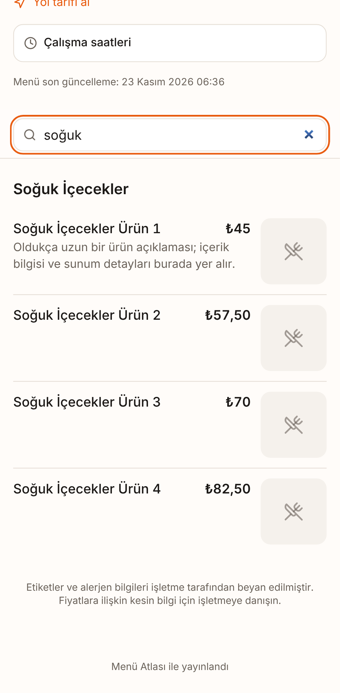

# Menü Atlası

Restoran ve kafeleri haritada keşfetmeyi, güncel menülerini ve fiyatlarını incelemeyi sağlayan mobil uygulama.
İşletmeler kendi hesaplarıyla menülerini yönetir, incelemeden sonra yayına alınır ve her işletme için kalıcı bir
QR menü bağlantısı oluşur.

Proje üç parçadan oluşur ve hepsi aynı Supabase backend'ini kullanır:

- **Mobil uygulama** (Flutter): işletme ve ürün keşfi, menüler, favoriler
- **Web paneli** (React): işletme sahipleri için menü yönetimi, yöneticiler için başvuru inceleme
- **QR menü sayfası** (web): hesap veya uygulama gerektirmeden telefonda açılan menü

> **Durum:** Çalışan MVP. Şu an herhangi bir sunucuda yayında değil; bilgisayarınızda Docker ile çalıştırılır
> (aşağıdaki [Kurulum](#kurulum) bölümü). Yayına alma adımları [docs/CONFIGURATION.md](docs/CONFIGURATION.md) içinde.

## Ekran görüntüleri

| İşletme paneli — menü yönetimi | İşletme paneli — QR menü |
|---|---|
|  |  |

| Mobil — keşfet | Mobil — işletme ve menü | Mobil — ürün arama | QR menü (telefon tarayıcısı) |
|---|---|---|---|
|  |  |  |  |

Ekran görüntülerindeki işletmeler ve fiyatlar kurgusal örnek veridir.

## Özellikler

### Kullanıcılar (mobil)
- Harita ve liste görünümü, “Bu bölgede ara” butonu, çok sayıda işaretçi için kümeleme
- İşletme veya ürün arama; restoran/kafe, mutfak türü, mesafe ve “şu an açık” filtreleri
- Konum izni vermeden şehir/ilçe seçerek keşif (izin yalnızca “Yakınımda” kullanılınca istenir)
- Ürün araması: “latte” gibi bir ürünü bölgedeki işletmelerde fiyatlarıyla bulma, bütçe sınırı, fiyata veya mesafeye göre sıralama
- İşletme sayfası: menü kategorileri, varyantlar (küçük/büyük), tükendi bilgisi, işletmenin beyan ettiği alerjen etiketleri, menü içinde arama, yol tarifi, arama
- Favoriler, hatalı bilgi bildirme, profil, şifre sıfırlama, hesap silme

### İşletme sahipleri (web paneli)
- E-posta doğrulamalı kayıt, birden fazla işletme/şube
- İşletme bilgileri, haritada konum seçme, logo ve kapak görseli (otomatik küçültülür), gece yarısını geçebilen çalışma saatleri ve özel günler
- Menü: kategori ve ürün ekleme/düzenleme/sıralama, ürün fotoğrafı, varyant fiyatları, gizleme, tükendi işareti
- Toplu fiyat güncelleme (yüzde veya sabit tutar), uygulamadan önce eski/yeni fiyat önizlemesi
- “Fiyatları kontrol ettim” kaydı, menü güncelleme tarihinden ayrı tutulur ve ayrı gösterilir
- Taslak → incelemeye gönder → yayın akışı, yayın öncesi menü önizlemesi
- Kalıcı QR menü bağlantısı, PNG ve SVG indirme (aynı bağlantı NFC etiketine yazılabilir)
- Gerçek görüntülemelere dayalı istatistikler (kişisel veri veya konum tutulmaz)
- İsteğe bağlı: menü fotoğrafı/PDF'inden AI ile aktarma. Sonuçlar taslak olarak gelir; işletme düzeltip onaylamadan menüye hiçbir şey eklenmez

### Yöneticiler (web paneli)
- Başvuruları menü önizlemesiyle inceleme, onaylama veya gerekçeyle reddetme
- İşletmeyi askıya alma, gerçek doğrulamadan sonra “Doğrulanmış” rozeti verme
- Kullanıcı bildirimlerini sonuçlandırma, tüm yönetim işlemlerinin kaydı (audit log)

### Güvenlik
- Tüm tablolarda Supabase satır düzeyi güvenlik (RLS); kimse başka bir işletmenin verisini değiştiremez
- Yayın durumu ve doğrulama rozeti yalnızca sunucu fonksiyonlarıyla değişir; işletme sahibi kendi onayını veremez
- Yönetici yetkisi kullanıcının düzenleyebildiği bilgilerden değil, istemcilerin yazamadığı ayrı bir tablodan gelir
- Taslak işletmelerin görselleri herkese açık değildir; fiyatlar kuruş cinsinden tam sayı olarak saklanır
- Bu kuralların hepsi otomatik testlerle doğrulanır ([docs/TESTING.md](docs/TESTING.md))

## Teknolojiler

| Katman | Teknoloji |
|---|---|
| Mobil | Flutter, Dart, Material 3, Riverpod, go_router, Google Maps |
| Web paneli ve QR menü | React, TypeScript, Vite, Tailwind CSS, shadcn/ui, Zod |
| Backend | Supabase: PostgreSQL + PostGIS, Auth, Storage, Edge Functions |
| Test | Vitest, Playwright, Flutter test |

## Proje yapısı

| Klasör | İçerik |
|---|---|
| `apps/mobile` | Flutter mobil uygulaması |
| `apps/business-web` | İşletme paneli, yönetim paneli ve QR menü sayfası |
| `supabase/migrations` | Veritabanı şeması, güvenlik kuralları ve sunucu fonksiyonları |
| `supabase/functions` | Edge Functions: hesap silme, AI ile menü aktarma |
| `supabase/seed.sql` | Yalnızca yerel geliştirme için kurgusal örnek veri |
| `supabase/tests` | Backend testleri (gerçek Supabase'e karşı çalışır) |
| `infra/local-supabase` | Supabase'i bilgisayarda Docker ile çalıştıran kurulum |
| `docs` | Kararlar, yapılandırma, test sonuçları |

## Kurulum

Gerekenler: [Docker Desktop](https://www.docker.com/products/docker-desktop/) (açık olmalı), Node.js 20 veya üstü, Git.
Windows'ta komutları **Git Bash** veya **WSL** içinde çalıştırın.

**1. Kodu indirin**
```bash
git clone https://github.com/beza0/MenuPusula.git
```
```bash
cd MenuPusula
```

**2. Backend'i başlatın** (ilk seferde Docker imajları indirildiği için birkaç dakika sürer)
```bash
bash infra/local-supabase/scripts/up.sh --seed
```
Bu komut yerel anahtarları üretir, Supabase'i başlatır, veritabanını kurar, örnek verileri yükler ve web panelinin
ayar dosyasını oluşturur. Sonunda `Migration tamam.` yazar.

**3. Web panelini başlatın**
```bash
cd apps/business-web
```
```bash
npm install
```
```bash
npm run dev
```

### Denemek için

| Adres | Ne var |
|---|---|
| http://localhost:5173/panel | İşletme ve yönetim paneli |
| http://localhost:5173/m/ornekmoda1 | Örnek QR menü (giriş gerektirmez) |
| http://localhost:54324 | Yerel e-posta kutusu (kayıt doğrulama e-postaları buraya düşer) |

Örnek hesaplar (yalnızca yerel örnek veride bulunur, şifre: `OrnekSifre123!`):

| Hesap | Rol |
|---|---|
| `ornek-sahip@menuatlasi.local` | Örnek işletmelerin sahibi |
| `ornek-yonetici@menuatlasi.local` | Yönetici (üst menüde “Yönetim” görünür) |
| `ornek-kullanici@menuatlasi.local` | Normal kullanıcı |

Durdurmak için:
```bash
bash infra/local-supabase/scripts/down.sh
```
Veritabanını sıfırlamak için:
```bash
bash infra/local-supabase/scripts/reset.sh --seed
```

### Mobil uygulama

[Flutter](https://docs.flutter.dev/get-started/install) gerekir. Backend çalışırken:
```bash
cd apps/mobile
```
```bash
cp env/local.example.json env/local.json
```
`env/local.json` içindeki `SUPABASE_ANON_KEY` değerini `infra/local-supabase/.env` dosyasındaki `ANON_KEY` ile
değiştirin (Android emülatörü bilgisayara `10.0.2.2` adresiyle erişir), sonra:
```bash
flutter run --dart-define-from-file=env/local.json
```
Google Maps anahtarı tanımlanmadıysa uygulama liste görünümüyle açılır ve harita alanında bir yapılandırma mesajı
gösterir. Anahtar kurulumu: [docs/CONFIGURATION.md](docs/CONFIGURATION.md#google-maps).

## Testler

Backend çalışırken tüm testler:
```bash
bash scripts/test-all.sh
```
Kapsam ve son sonuçlar: [docs/TESTING.md](docs/TESTING.md).

## Yayına alma

Supabase projesi, web panelinin yayınlanması, ilk yöneticinin güvenli oluşturulması, harita ve e-posta ayarları:
[docs/CONFIGURATION.md](docs/CONFIGURATION.md). Henüz tanımlanmamış harici ayarların listesi de aynı dosyada.

### İlk yönetici

Yönetici yetkisi uygulama içinden verilemez. Kişi önce normal hesap açıp e-postasını doğrular; ardından veritabanı
sahibi Supabase SQL Editor'de şunu çalıştırır:
```sql
insert into public.admin_users (user_id, note)
select id, 'İlk yönetici' from auth.users where email = 'yonetici@alanadiniz.com';
```

## Marka

Uygulama adı, logo ve renkler tek yerden değişir: web için `apps/business-web/src/config/brand.ts` ve
`public/logo.svg`, mobil için `apps/mobile/lib/config/brand.dart`.

## Belgeler

- [docs/CONFIGURATION.md](docs/CONFIGURATION.md) — ortam değişkenleri, harita, e-posta, AI, yayına alma, eksik ayarlar
- [docs/TESTING.md](docs/TESTING.md) — test kapsamı ve sonuçları
- [docs/DECISIONS.md](docs/DECISIONS.md) — teknik kararlar ve gerekçeleri
- [docs/PLAN.md](docs/PLAN.md) — geliştirme planı
